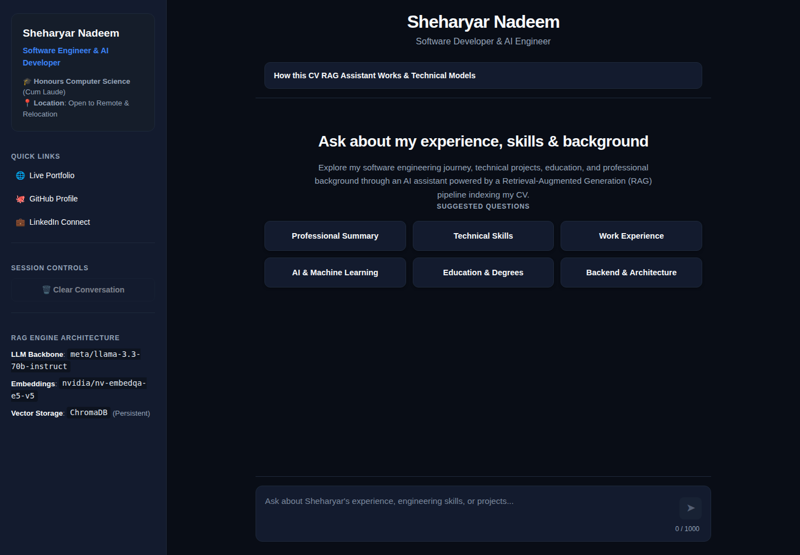

# AI Portfolio Knowledge Base // Interactive RAG Assistant & FastAPI Backend

An interactive, evidence-grounded Retrieval-Augmented Generation (RAG) knowledge base that indexes a candidate's complete professional corpus, including CVs, academic theses, project case studies, system architecture notes, and certifications. Built with **FastAPI**, **Next.js**, **LangChain**, **NVIDIA AI Endpoints**, and **ChromaDB**.

Recruiters, hiring managers, and engineers can explore broad career highlights or deep technical project details simultaneously through a responsive Next.js web interface or a high-performance REST/SSE API with verifiable document and page-level citations.

---

## Key Highlights

- **Multi-Document Ingestion**: Automatically scans, parses, and indexes any collection of `.pdf`, `.md`, or `.txt` files placed in `documents/` (e.g., CVs, thesis papers, project writeups, and technical documentation).
- **Cross-Document Semantic Search**: Powered by NVIDIA QA & Text Embeddings (`nvidia/nv-embedqa-e5-v5`) stored in a local, persistent ChromaDB vector store, enabling cross-referencing across diverse documents.
- **Bullet-Aware Text Splitting**: Preserves resume formatting, technical lists, and project sections with tuned chunk sizes (`chunk_size=700`, `overlap=140`) to maintain semantic context continuity.
- **Conversational Context Reformulation**: Automatically detects and reformulates pronoun-heavy follow-up questions (e.g., *"What technologies did he use for that project?"*) into standalone search queries using conversational history.
- **Evidence-Grounded Streaming**: Synthesizes responses via Meta Llama 3.3 70B Instruct (`meta/llama-3.3-70b-instruct`) with strict evidence grounding and granular source citation expanders.
- **FastAPI Production Backend**: Async, production-grade REST & SSE streaming API with structured health checks (`/api/v1/health/live`, `/api/v1/health/ready`), CORS validation, body size caps, and concurrency throttling.
- **Modern Next.js Frontend**: Responsive interface with streaming chat, interactive source citations, suggestion pills, and dark aesthetic.
- **100% Offline Test Suite**: Comprehensive mocked unit and integration test suite that runs in seconds without making network requests or consuming API credits.

## Screenshots

The portfolio assistant opens with suggested questions and a streaming chat composer, alongside profile details and the RAG stack.



---

## Architecture

```text
       ┌────────────────────────┐       ┌────────────────────────┐
       │   Next.js Frontend     │       │    FastAPI Backend     │
       │      (Port 3000)       │──────▶│      (Port 8000)       │
       │      (frontend/)       │  SSE  │ (backend.app.main:app) │
       └────────────────────────┘       └───────────┬────────────┘
                                                    │
                                                    ▼
                                         CVChatEngine / RAGPipeline
                                         ├── Multi-Document Ingestion (PDF / MD / TXT)
                                         ├── Vector Store Manager (ChromaDB + NVIDIA Embeddings)
                                         └── Conversational Synthesis (Prompt Injection Defense + NVIDIA NIM)
```

The RAG engine initializes on startup, builds or connects to the local ChromaDB index, and provides isolated session memory for each connected user.

---

## Quick Start & Local Setup

### Runtime Requirements
- **Python**: 3.12 (standardized across Docker, devcontainer, CI, and local development)
- **Node.js**: 24 LTS (or 22+) & npm
- **Docker Engine & Docker Compose**: 24+ (optional for containerized deployment)

---

### Option 1: Docker Compose (Recommended)

Start the complete full-stack system (FastAPI backend + Next.js frontend + persistent Chroma volume):

```bash
# Offline mode with simulated fake AI providers (zero credentials required)
PROVIDER_MODE=fake docker compose up -d --build

# Or live mode with NVIDIA NIM credentials
cp .env.example .env
# Set NVIDIA_API_KEY=nvapi-... in .env
docker compose up -d --build
```

Wait for backend readiness and open the app:
```bash
python scripts/wait-for-ready.py
open http://localhost:3000
```

---

### Option 2: Running Directly on Host

#### 1. Backend Setup (Python 3.12)

```bash
# Create and activate virtual environment
python3 -m venv .venv
source .venv/bin/activate  # Or on Windows: .\.venv\Scripts\Activate.ps1

# Upgrade pip and install dependencies
python -m pip install --upgrade pip
python -m pip install -r requirements-dev.txt

# Configure environment
cp .env.example .env
# Edit .env and set NVIDIA_API_KEY (or set PROVIDER_MODE=fake for offline work)

# Run FastAPI backend
uvicorn backend.app.main:create_app --factory --host 0.0.0.0 --port 8000 --reload
```

Interactive OpenAPI documentation is available at:
- Swagger UI: [http://localhost:8000/docs](http://localhost:8000/docs)
- ReDoc: [http://localhost:8000/redoc](http://localhost:8000/redoc)

#### 2. Frontend Setup (Node.js 24 LTS)

```bash
cd frontend
npm install
npm run dev
```

Open [http://localhost:3000](http://localhost:3000) in your browser. The Next.js frontend communicates through a server-only proxy route (`/api/chat`) to the FastAPI backend with Server-Sent Events (SSE) streaming and verifiable evidence excerpts.

> **Deployment Guide**: See [docs/deployment.md](docs/deployment.md) for full container architecture, production single-instance persistence, Vercel frontend deployment, and security guardrails.

---

## API Endpoints

The FastAPI backend exposes the following REST and streaming endpoints under `/api/v1`:

### Health Probes

- **`GET /api/v1/health/live`**: Liveness probe returning status `200 OK` with `{"status": "live"}`.
- **`GET /api/v1/health/ready`**: Readiness probe returning status `200 OK` with `ReadinessResponse` when the vector database and pipeline are fully initialized (`{"state": "ready", "reason_codes": [], "pipeline_version": "dense-v1", "index_fingerprint": null}`), or `503 Service Unavailable` with detailed reason codes when initializing or degraded.

### Synchronous Chat

- **`POST /api/v1/chat`**: Synchronous question answering endpoint returning structured JSON with factual citations and decisions.

```bash
curl -X POST http://localhost:8000/api/v1/chat \
  -H "Content-Type: application/json" \
  -d '{
    "question": "What is the candidate experience with Python?",
    "history": [
      {"user": "Hello", "assistant": "Hi! How can I help you today?"}
    ]
  }'
```

### Streaming Chat (SSE)

- **`POST /api/v1/chat/stream`**: Server-Sent Events (SSE) streaming endpoint emitting monotonic Schema Version 1 events (`retrieval_started`, `retrieval_completed`, `generation_started`, `answer_delta`, `answer_completed`).

```bash
curl -X POST http://localhost:8000/api/v1/chat/stream \
  -H "Content-Type: application/json" \
  -d '{
    "question": "What is the candidate experience with Python?"
  }'
```

---

## Document Ingestion & Chunking Rules

- **Supported File Types**: `.pdf`, `.md`, and `.txt` files placed directly in `documents/`.
- **Automatic Exclusions**: Hidden files (prefixed with `.`), nested subdirectories, and files named `README.md`.
- **Idempotent Indexing**: Document chunks are hashed with SHA-256 identities to ensure repeat runs or additional files do not create duplicate vector entries.
- **Cross-Document Citations**: Each generated response cites the exact document source filename and page number so claims can be audited directly against the original text.

---

## RAG Evaluation Framework

The repository includes a native evaluation framework (`evaluation/`) for measuring retrieval performance, answer correctness, fact coverage, citation fidelity, and abstention behavior against versioned golden datasets.

### Running Evaluations

```powershell
# Run evaluation with a specific configuration preset (e.g. dense-baseline, hybrid-no-rerank, hybrid-rerank)
python -m evaluation.runner --dataset evaluation/datasets/cv_golden.jsonl --config hybrid-no-rerank --output evaluation/baselines/hybrid.json

# Run evaluation with optional NVIDIA LLM-as-a-judge scoring
python -m evaluation.runner --dataset evaluation/datasets/cv_golden.jsonl --config hybrid-rerank --judge --output evaluation/baselines/rerank_judged.json
```

### Comparing Baselines

```powershell
# Compare two evaluation runs and inspect macro deltas, category breakdowns, and regression warnings
python -m evaluation.compare evaluation/baselines/dense.json evaluation/baselines/hybrid.json
```

### Metrics Tracked

- **Retrieval**: `Hit@K`, `Recall@K`, `AllEvidence@K` (multi-hop group coverage), and `MRR`. Ground truth is tied to document anchors `(source, page, anchor)` and does not depend on ephemeral chunk IDs.
- **Answer & Facts**: `required_fact_coverage`, `forbidden_fact_violation`, `exact_match`, and `correct_abstention_rate` (tested with token boundaries and alias matchers).
- **Citations**: `citation_id_validity`, `claim_citation_coverage`, and `locator_accuracy`.
- **Calibration**: Stratified 5-fold cross-validation with cost objective ($5 \times \text{false\_answer} + 1 \times \text{false\_abstention}$) and 95% bootstrap confidence intervals.

---

## Running Offline Tests & Diagnostics

Validate the codebase and run test suites:

```powershell
# Verify syntax and compilation across all modules
python -m compileall -q backend evaluation rag tests scripts test_pipeline.py

# Run offline pytest suite with isolated temporary directory (zero network calls)
python -m pytest -q

# Validate package dependency consistency
python -m pip check

# Run frontend unit & component tests (Vitest + React Testing Library)
cd frontend
npm test

# Run frontend browser end-to-end integration tests (Playwright)
npm run test:e2e
```

Run the live diagnostic script to verify vector indexing and embedding connectivity against your local documents:

```powershell
# Verify document loading and ChromaDB vector search
python test_pipeline.py

# Optionally test one live LLM synthesis request
python test_pipeline.py --with-llm
```

---

## Common Issues & Troubleshooting

### 1. "The response stream was interrupted before completion" / Embedding Dimension Mismatch

- **Symptom**: Chat responses fail mid-stream or backend logs show `InvalidArgumentError: Collection expecting embedding with dimension X, got Y`.
- **Cause**: The local ChromaDB vector store (`vector_db/`) was previously indexed with a different embedding model dimension (e.g. 4096-dim) than the current active model (`nvidia/nv-embedqa-e5-v5`, 1024-dim).
- **Solution**: Delete the local `vector_db/` directory and restart the backend. The backend will automatically rebuild the index with the correct dimensions on startup:
  ```powershell
  # PowerShell (Windows)
  Remove-Item -Recurse -Force vector_db
  
  # Bash (Linux/macOS)
  rm -rf vector_db
  ```

### 2. Missing or Invalid NVIDIA API Key

- **Symptom**: Startup validation error `NVIDIA_API_KEY is not configured` or 401 Unauthorized upstream responses.
- **Solution**:
  - **Live Mode**: Ensure `.env` contains a valid key:
    ```bash
    NVIDIA_API_KEY=nvapi-your-key-here
    ```
  - **Offline Mode**: Run without any API key or credentials by setting:
    ```bash
    PROVIDER_MODE=fake
    ```

### 3. Frontend Cannot Reach Backend (503 Service Unavailable / Connection Refused)

- **Symptom**: Next.js logs show `Backend proxy request failed: Connection refused` or status 503.
- **Solution**:
  - Verify that the FastAPI backend is running on `http://127.0.0.1:8000`.
  - Test backend health:
    ```bash
    curl http://127.0.0.1:8000/api/v1/health/live
    ```
  - If running backend on a custom port or host, set `BACKEND_URL` in the frontend environment (e.g. `BACKEND_URL=http://127.0.0.1:8000`).

### 4. Port Conflicts (Port 8000 or 3000 Already in Use)

- **Symptom**: `error: [Errno 10048] error while attempting to bind on address ('127.0.0.1', 8000)`.
- **Solution**:
  - Check and stop the existing process occupying the port:
    ```powershell
    # Windows PowerShell
    Get-Process python -ErrorAction SilentlyContinue | Stop-Process -Force
    ```
  - Or run the backend on a different port:
    ```bash
    uvicorn backend.app.main:create_app --factory --port 8001
    ```

### 5. Running Offline Tests (Network Isolation)

- **Symptom**: `AssertionError: Unit tests must not access the network` during test runs.
- **Solution**: The test suite enforces strict offline execution. All tests use mocked provider factories (`FakeProviderFactories`, `FakeEmbeddings`, `FakeChatModel`). Run the suite with:
  ```bash
  python -m pytest -q
  ```
