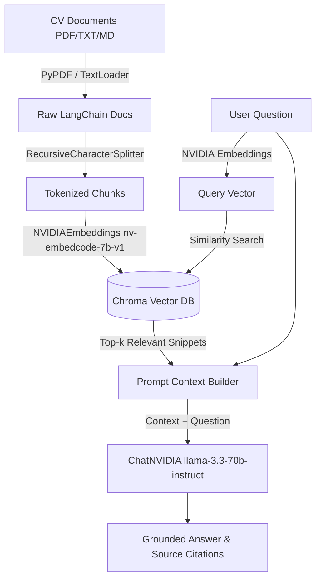

# RAG CV / Resume Chatbot in LangChain

An enterprise-grade Retrieval-Augmented Generation (RAG) pipeline built with **LangChain**, **NVIDIA AI Endpoints**, **ChromaDB**, and **Streamlit**. It loads documents (PDF, Markdown, TXT) from the `documents/` folder, performs tokenization and chunking, indexes them into a persistent vector database, and provides an interactive web chat UI and CLI interface for querying candidates' CVs.

---

## Key Features

- **Multi-Format Document Parsing**: Automatically ingests PDFs (`PyPDFLoader`), Text, and Markdown files from `./documents`.
- **Tokenization & Recursive Chunking**: Uses `RecursiveCharacterTextSplitter` (chunk size: 700, overlap: 140) to preserve semantic context across chunk boundaries.
- **NVIDIA AI Embeddings**: Embeds text chunks using `nvidia/nv-embedcode-7b-v1` into high-dimensional vector space.
- **Persistent Vector Storage**: Uses **ChromaDB** to store vector embeddings and document metadata with disk persistence (`./vector_db`).
- **State-of-the-Art LLM**: Powered by Meta `meta/llama-3.3-70b-instruct` via **ChatNVIDIA** endpoints.
- **Interactive Web Interface**: Streamlit UI with Industrial Skeuomorphism aesthetic, suggested question chips, citation drawers, and session memory.
- **Source Attributions**: Every LLM response cites the exact CV text snippets used to synthesize the answer.

---

## Architecture Workflow



---

## Repository Structure

```
cv_rag_pipeline/
├── .env                    # Environment configuration (API keys & model names)
├── .env.example            # Environment template
├── .gitignore              # Excludes vector_db, secrets, and caches
├── requirements.txt        # Python package dependencies
├── README.md               # Documentation
├── documents/              # Place CV PDFs, TXT, or MD files here
│   ├── Candidate_CV.pdf    # Candidate CV / Resume (ignored by git)
│   └── README.md
├── vector_db/              # ChromaDB persistent storage directory
├── rag/                    # RAG engine package
│   ├── __init__.py         # Package exports
│   ├── config.py           # Configuration & environment loader
│   ├── document_loader.py  # Multi-format document loader & tokenizer
│   ├── vector_store.py     # ChromaDB vector store & embeddings manager
│   └── engine.py           # Conversational RAG pipeline & LLM prompt chain
├── app.py                  # Streamlit Web Chat Interface
└── test_pipeline.py        # Diagnostic & unit test runner
```

---

## Quick Start Guide

### 1. Prerequisites & Environment Setup

Ensure Python 3.10+ is installed. Clone this repository and install the dependencies:

```bash
pip install -r requirements.txt
```

### 2. Configure NVIDIA API Key

Create or edit the `.env` file in the root directory and add your NVIDIA AI Foundation Endpoints API Key:

```ini
NVIDIA_API_KEY=nvapi-your-key-here
EMBEDDING_MODEL=nvidia/nv-embedcode-7b-v1
LLM_MODEL=meta/llama-3.3-70b-instruct
```

### 3. Add CV Documents

Drop your CV / Resume into the `documents/` directory (`.pdf`, `.txt`, `.md`). The system will automatically scan, split, tokenize, and index all documents upon launch.

---

## Running the Applications

### Option A: Launch the Web Chat Interface (Streamlit)

```bash
streamlit run app.py
```
Open your browser to `http://localhost:8501`.

### Option B: Run Diagnostic Tests

To verify document loading, tokenization, vector indexing, and RAG answer generation:

```bash
python test_pipeline.py
```

---

## Code Comments & Implementation Highlights

- **Tokenization / Text Splitting** (`rag/document_loader.py`):
  Detailed explanations on how `RecursiveCharacterTextSplitter` breaks text on natural paragraph and line boundaries, ensuring chunks stay within LLM context budgets while maintaining semantic integrity with `chunk_overlap`.
- **Vector Database & Embeddings** (`rag/vector_store.py`):
  Documents how `NVIDIAEmbeddings` generates mathematical vector representations and how Chroma stores vector coordinates and metadata for fast similarity search.
- **RAG Prompt Engineering** (`rag/engine.py`):
  Examines how retrieved context snippets are dynamically injected into ChatNVIDIA system prompts to enforce strict factual grounding and eliminate hallucinations.
